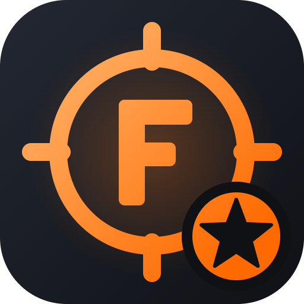

<h1 align="center">FragLab Highlights</h1>

Turn your CS2 recordings into a highlight video automatically: drop in your clips, and it finds the fights and kills and cuts them together. Part of the <b>FragLab</b> family.

<a href="https://github.com/M0RTENS3N/fraglab-highlights/releases/latest"><b>⬇ Download the latest version</b></a>

---

## What it does

- **Step by step:** 1 Song, 2 Clips, 3 Genre, 4 Theme, 5 Create, with a hint on every step and the fine-tuning under More options. Your recordings show up as a picture grid with your kills marked; click to add them (Shift-click or "Pick all shown" for many at once), or drag and drop any video.
- **Finds your kills:**
  - reads the CS2 kill feed, so it knows when **you** got a kill, a **2K**, **3K**, **4K** or an **ACE**;
  - your deaths and the kills of teammates you were spectating are left out;
  - gunshots in the game audio find the rest of the fights.
- **Scored moments:** multi-kills score highest. Each clip shows a timeline with your kills marked, and you can preview any moment and pick or unpick it.
- **Choose your style:**
  - length: **Tight** (multi-kills only), **Balanced** (every kill of yours) or **Everything**;
  - **slow motion** on the last kill, **2K / 3K / ACE banners**, and your video's name as a title;
  - order: as played, or **best last** so the video builds up to your biggest play;
  - **widescreen** for YouTube or **vertical 9:16** for TikTok, Shorts and Reels;
  - 4:3 recordings with black bars or **stretched** to fill the screen;
  - seconds to keep before and after each moment, and fades between clips;
  - 720p, 1080p or 1440p at 30 or 60 fps;
  - game volume, plus optional background music with its own volume.
- **Themes:** Cyberpunk (neon, scanlines, a glitch on every kill), VHS, Noir and Sunset put a look over the whole video, with matching banner colours.
- **Kill on every beat:** a music mode where every kill lands on its own beat; clips speed up between kills and sprays stretch over several beats.
- **Genres:** one click sets the style and picks the moments:
  - **Frag movie:** all your kills in order, with slow motion and banners;
  - **Best plays:** only multi-kills, building up to the best one;
  - **TikTok / Shorts:** vertical, your best kills, under a minute;
  - **Clean:** every kill of yours, no effects;
  - **Describe it (AI):** type what you want and the AI plans the video and writes a title.
- **AI with Ollama (optional):** [Ollama](https://ollama.com) runs on your own PC, so nothing is uploaded. It reads the killer's name on each kill-feed row, so only your kills are used. The Settings page sets it up with one button.
- **Music that fits:** a playlist of your own songs, songs from a YouTube link, or built-in beats (Hype, Phonk, Chill, made by the app and free to use). Songs blend on the beat with no silence, every kill and cut can land on a beat, and the video can end with the music. Songs with a long intro: the drop can land on your first kill, and the intro can be filled with other footage (deaths, fights, round starts).
- **Plan with rules:** 'Describe it' turns your words into rules you can see and change (fast kills, no deaths, length, order, format), so the same request always gives the same video.
- **Quick setup:** the first start gets every name from your Steam account (so kills under old names count too), installs the AI with one button and finds your recordings.
- **Intro, outro and banners:** each in its own place with a picture of every design. Intros: centred, cinematic, minimal, split or boxed; outros: thanks, GG, GG WP with your stats, split, minimal or a fade. Multi-kill banners (slanted, stamp, pill, corner tag, broadcast bar, outline, minimal, or just a slanted line per kill) stay up and count on with every kill.
- **Demo Studio:** six steps built around your song: song, demos, genre, theme, record, create. Pick one or more CS2 demos and FragLab finds your kills; "Pick for the song" fills the song with your best plays. A free-camera intro (fly-in, orbit, rise or side; preview them all and pick one) opens the video, and bullet time circles you just before your best kill. The bullet cam follows the shot from your gun to the enemy, and the FragLab HUD replaces CS2's HUD with a clean kill feed. CS2 then plays them with a montage camera: cinematic free-camera shots that follow the player without going through walls (FragLab maps where players walked) (high behind them, beside them or over the shoulder, made with HLAE, which FragLab downloads for you), the enemy's eyes, and first person for every kill. Or one camera for everything: first person, third person, enemy POV or cinematic. It shows which songs the montage is cut to, and closes CS2 when it's done. Choose only the kill feed, no HUD or the full HUD. HLAE records every kill straight to video, faster than real time at a perfect 60 fps (or OBS, which FragLab installs and sets up, or you record it yourself), and the clips go straight into your highlight.
- **Automatic FACEIT highlights:** download a FACEIT match demo (Watch demo) and FragLab finds it, unpacks it and tells you or makes the whole highlight by itself. Switch it on or off in Settings.
- **Special kills:** ferrari peeks, HE nades and clutches (1v2 to 1v5) are found in the demo and tagged in the video; on crazy kills (ferrari peeks, nades, wallbangs, through smoke, no-scopes, jumpshots, flashed, clutches) the enemy's view slides in as a card next to yours. Every kill can have its own camera: first person, third person, enemy POV, the enemy view card or an instant replay (your kill, a rewind, then the enemy's view).
- **Clean up:** demo clips and FACEIT demos go to the Recycle Bin after two weeks, or with one click in Settings.
- **Team montage:** the Demo Studio can also record the kills of everyone on your side, over one or more matches, each through their own eyes and in match order, with each player's name shown in the video.
- **Slow motion your way:** on the last kill, every kill, only one-taps, only sprays or only no-scopes.
- **Timeline editor (PRO):** see the moments lined up like in a video editor; reorder, trim or take some out, then make the video again.
- **Polished:** the FragLab startup animation, smooth page changes, and animations that turn off when Windows reduce-motion is on.
- **Fast:** videos are made on your graphics card when it can (NVIDIA, AMD or Intel), and clips you've added before open instantly.
- **Library:** all your finished highlight videos in one place, so you can play them, show them in their folder, or delete them.
- **Themes:** the same six themes as the other FragLab apps.

## Install

1. Download `FragLab-Highlights-Setup-x.y.z.exe` from the [latest release](https://github.com/M0RTENS3N/fraglab-highlights/releases/latest).
2. Run it. It needs no admin rights and installs to your user folder. ffmpeg is included, so there's nothing else to install.
3. Open **FragLab Highlights** from the Start Menu, drop your recordings on **Create**, and click **Make highlight**.

Updates come through the **Update** button in the app.

**Requirements:** Windows 10 or 11 (64-bit). Recordings need game sound to find the fights.

## Privacy

Everything runs on your PC. Your videos never leave it, and nothing is uploaded.

---

Not affiliated with Valve. Counter-Strike 2 is a trademark of Valve Corporation.
